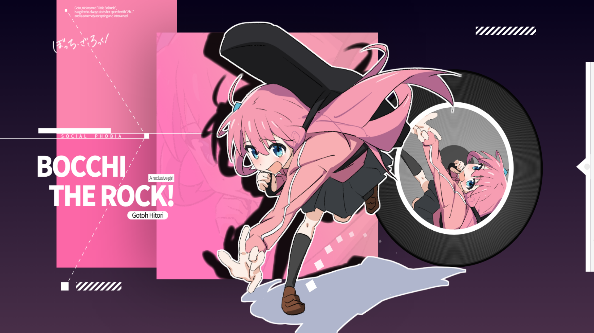
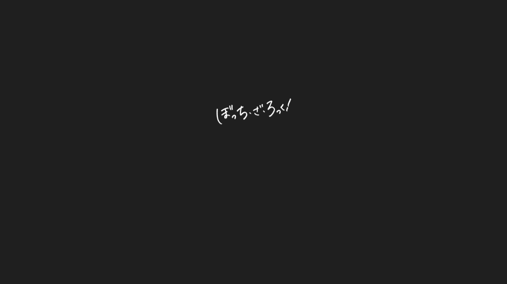
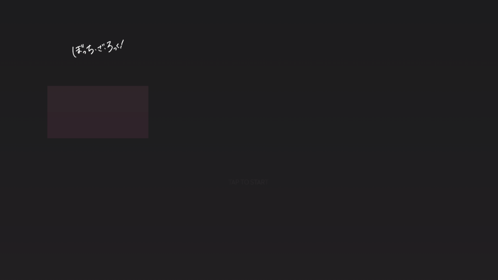
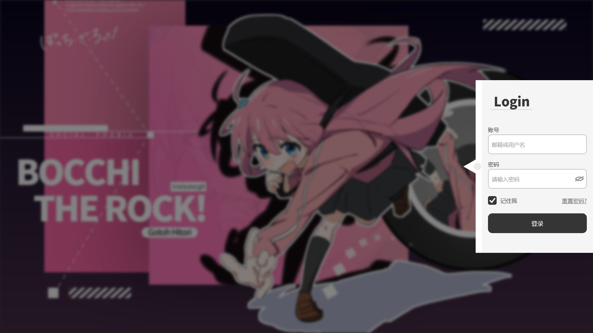
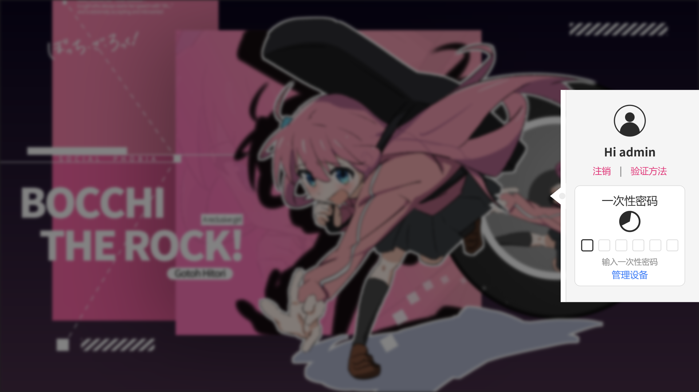

# Bocchi Client 启动界面 — Web 复刻

[English](README.md) · **简体中文**

本项目是 [**baier233/bocchi-template-1.21.5**](https://github.com/baier233/bocchi-template-1.21.5)
启动界面的 Web 复刻。原模组使用 Skija（Skia 的 Java 绑定）绘制，这里则是在浏览器里重画同一块界面：
Canvas 2D 上下文重放相同的绘制指令、坐标公式、贝塞尔求值、`saveLayer` 语义与字体度量 ——
不是照着截图仿出来的近似品。

只复刻前端，不含任何游戏逻辑，也不会向 Minecraft 注入任何东西。

唯一有意的改动：把原模组右侧的按钮栏（单人 / 多人 / 账号管理 / 选项）换成了一个可用的演示
**登录面板** —— 账号、密码、记住我、一次性密码步骤和已登录的账号视图。与界面其余部分不同，它是
用**真实 DOM 节点**搭出来的（而不是画在 canvas 上），所以可以直接在开发者工具里查看、复制和修改。
它保留了原版的字体、配色与悬停动画，账号数据不会离开浏览器（见[范围与已知差异](#范围与已知差异)）。



| 启动页 · 加载中 | 启动页 · TAP TO START |
| --- | --- |
|  |  |

| 启动页 → 菜单 过渡 | 登录面板 |
| --- | --- |
|  |  |

| 已登录 · 一次性密码 |
| --- |
|  |

<sub>以上截图均为 1920×1080（GUI 缩放 4）。`screenshots/menu-720p.png` 是同一界面在
1280×720（GUI 缩放 3）下的效果，用来验证整套布局确实由 Minecraft 的 GUI 缩放驱动。</sub>

---

## 快速开始

```bash
pnpm install
pnpm dev            # 开发服务器（HMR）
pnpm run build      # 生产构建 → dist/
pnpm preview        # 用 vite 预览构建产物
```

开发时使用的是 Node 24 / pnpm 11，`pnpm-lock.yaml` 是权威的 lockfile。不想装依赖的话，构建产物
也可以直接用 `tools/` 里那个零依赖的静态服务器跑起来：

```bash
node tools/serve.mjs dist 5173
```

然后打开 <http://localhost:5173/>。默认走的就是真实流程：先出现启动页，约 3 秒后 **TAP TO START**
淡入，点击后主菜单在背后淡入。

## URL 参数

所有参数都是可选的，存在的意义是让某一帧可以被确定性地复现。

| 参数 | 默认值 | 说明 |
| --- | --- | --- |
| `?stage=menu` | `splash` | 跳过启动页，直接进主菜单。 |
| `?at=<ms>` | – | 把虚拟时钟定格在 `<ms>`：按 1/60 秒步进重放整条时间轴，然后渲染一帧，不启动渲染循环。 |
| `?click=<ms>` | – | 在 `<ms>` 时刻模拟一次点击（驱动启动页 → 菜单的过渡）。 |
| `?guiScale=<n>` | 自动 | 强制 GUI 缩放。默认按 Minecraft 的 `Window#calculateScale` 从画布尺寸推算。 |
| `?panel=1` | – | 强制展开右侧面板（正常只有鼠标悬停才会展开）。 |
| `?load=<ms>` | `1200` | 模拟的加载时长，决定淡出从什么时候开始。 |

示例：

```
/?at=3600                          # "TAP TO START" 那一帧
/?stage=menu&at=6000               # 完全稳定后的主菜单
/?stage=menu&at=6000&panel=1       # 展开面板的主菜单
/?at=4700&click=4000               # 启动页与菜单的过渡中途
```

> `?at=` 是**同步**重放，所以在 1920×1080 下给一个很大的值会把主线程卡住一段时间（headless 软件
> 渲染下约 30 秒）。它是调试和截图用的工具，不是功能。

## 还原思路

贯穿始终的原则是：**什么都不"修正"**。原码里哪条公式写得奇怪，移植过来就还是那条公式，这样两边
才能出一样的像素。（登录面板是唯一的有意例外：它用 DOM 渲染，而不是画在 canvas 上，见
[范围与已知差异](#范围与已知差异)。）

### GUI 缩放

画布后备缓冲扮演 Minecraft 的 framebuffer：尺寸是 `CSS 像素 × devicePixelRatio`，GUI 缩放由它按
`Window#calculateScale` 的规则算出（`i = 1; while (i < 4 && floor(w/(i+1)) >= 320 && floor(h/(i+1)) >= 240) i++`），
画布变换就是这个缩放。之后所有代码都用 GUI 单位书写。

### 字体与文本度量

`SkiaFontRenderer` 绘制前会把画布缩放 `0.5`，所以 Java 里传的 `size` 实际显示为 `size / 2`。行高取自
字体的 `hhea` 表（`lineGap + ascent + descent` —— 这些字体都没有开启 OS/2 的 `USE_TYPO_METRICS`，
所以 Skia 用 `hhea`），字宽取自 `hmtx`。

这两项都由 `tools/gen-font-metrics.py` 提前抽取到 `src/engine/metrics.js`，因此文本宽度和行高在
任何浏览器里都完全一致，不依赖各平台自己的字体回退。

### 图层

Skia 的 `saveLayer` / `saveLayerAlpha` 在设备空间栅格化，再按 alpha 和/或图像滤镜合成。
`Gfx#pushLayer` / `popLayer` 用一组离屏画布做同样的事。这一点很关键：开场动画会叠加大量半透明
图形，如果直接用 `globalAlpha`，重叠处会被压暗，而不是把整组当作一个整体去合成。

### 模糊与膨胀

- `ImageFilter.makeBlur(sigma)` 与 CSS `blur()` 的 `sigma` 同义，所以按 `blur(sigma * scale px)`
  输出 —— sigma 是局部（GUI）单位，会被 CTM 缩放。
- `ImageFilter.makeDilate(1, 1)` 是 3×3 最大值滤波，等价于 9 个位移副本的并集。这里预先烘焙成一张
  贴图再整体画一次，而不是画 9 次（画 9 次会在重叠处把 alpha 抬高）。

### 图标

SVG 图标先按目标尺寸离屏渲染，再用 `source-in` 填色 —— 也就是 Canvas 2D 里等价于
`ColorFilter.makeBlend(color, SRC_IN)` 的写法。

### 动画

`BezierAnimation` 连同它 11 项的采样表、牛顿迭代、`then(next, triggerProgress)` 链式触发一起照搬
（包括原实现里二分分支的那个小怪癖）。因此开场动画的时间轴和游戏里一致。

### 刻意保留的"奇怪"写法

比如 `TextElementsComponent` 用 `blockSize * 0.05 - halfHeight / 2` 定位三行简介文字，漏掉了
`block1Pos.y`（所以它们会跑到屏幕很靠上的位置）；`BgRectsComponent` 里那条 `drawRectLTRB` 会在
`block1` 上方铺出一条浅粉色块。这些都按原码复刻。

## 目录结构

```
.
├── index.html
├── vite.config.js
├── public/assets/            # 从模组里拷出来的贴图、图标、字体
├── screenshots/              # 参考截图（见上）
├── tools/
│   ├── gen-font-metrics.py   # TTF → src/engine/metrics.js
│   └── serve.mjs             # 零依赖静态服务器
└── src/
    ├── main.js               # Vue 入口
    ├── App.vue               # 画布宿主
    ├── style.css             # @font-face 声明 + 全屏画布
    ├── app.js                # GUI 缩放、启动页 → 菜单状态机、渲染循环
    ├── engine/               # 对应 Skia 调用的 Canvas 2D 后端
    │   ├── gfx.js            #   SkiaContext / SkiaRenderEngine + saveLayer
    │   ├── font.js           #   SkiaFontRenderer / FontSet
    │   ├── bezier.js         #   BezierAnimation / BezierControlPoints
    │   ├── color.js          #   ColorUtil / ARGB
    │   ├── assets.js         #   图片加载、着色、膨胀
    │   ├── frame.js          #   *FrameContext（布局公式）
    │   ├── metrics.js        #   生成的字体度量
    │   └── time.js           #   虚拟时钟（供 ?at= 使用）
    └── ui/
        ├── common/           # 黑胶、logo 渲染、文本框、呼吸动画
        ├── misayos/          # 主菜单各组件与屏幕
        │   ├── guiComponent.js   # 登录面板的模型（状态 + 展开/模糊动画）
        │   ├── guiDom.js         # 登录面板本体（真实 DOM）
        │   └── panelLayout.js    # 共享的卡片布局常量
        └── splash/           # SplashUI + LoadingAnimateRenderer
```

## Java → JS 对应表

| Java（`common/src/main/java/`） | JS（`src/`） |
| --- | --- |
| `me.baier.graphics.SkiaContext` | `engine/gfx.js` |
| `me.baier.graphics.font.SkiaFontRenderer` / `FontSet` | `engine/font.js` |
| `me.baier.animation.BezierAnimation` / `BezierControlPoints` | `engine/bezier.js` |
| `me.baier.utils.ColorUtil` / `net.minecraft.util.ARGB` | `engine/color.js` |
| `me.baier.utils.RenderUtils` | `ui/common/renderUtils.js` |
| `me.baier.utils.ScreenUtils.calculateStartPosition` | `ui/misayos/mainTachie.js` |
| `me.baier.client.ui.model.*FrameContext` | `engine/frame.js` |
| `client.ui.common.components.AlbumRenderer` | `ui/common/album.js` |
| `client.ui.common.components.LogoRenderer` | `ui/common/logoRenderer.js` |
| `client.ui.mainmenu.common.LogoComponent` | `ui/misayos/logo.js` |
| `client.ui.mainmenu.misayos.BgRectsComponent` | `ui/misayos/bgRects.js` |
| `client.ui.mainmenu.misayos.StrokeElementsComponent` | `ui/misayos/strokeElements.js` |
| `client.ui.mainmenu.misayos.TextElementsComponent` | `ui/misayos/textElements.js` |
| `client.ui.mainmenu.misayos.MainTachieComponent` | `ui/misayos/mainTachie.js` |
| `client.ui.mainmenu.misayos.GuiComponent`（+ `childs/*`） | `ui/misayos/guiComponent.js`（模型）、`guiDom.js`（DOM 渲染）、`panelLayout.js` |
| `client.ui.mainmenu.misayos.MainMenuMisayosScreen` | `ui/misayos/screen.js` |
| `client.ui.splash.SplashUI` / `LoadingAnimateRenderer` | `ui/splash/splash.js` |
| `injection.mixins.transformers.MixinSplashOverlay`（时序） | `app.js` 的 `tick()` |

## 重新生成字体度量

`src/engine/metrics.js` 是从 `public/assets/` 里的 TTF 生成的。换字体后重新跑一次：

```bash
python tools/gen-font-metrics.py
```

它会解析 `head`、`hhea`、`hmtx`、`cmap`，输出渲染器需要的 upem、hhea 的 ascent/descent/lineGap
以及每个字符的 advance 宽度。

## 范围与已知差异

- **只绘制作者自己写的那套 UI。** 没有复刻原版 `Screen.renderBackground` 的整屏渐变遮罩；
  Misayos 屏幕本身会画一层不透明渐变，就以它为准。
- **按钮栏被换成了演示登录面板，且用 DOM 渲染。** 原模组的单人 / 多人 / 账号管理 / 选项按钮被替换为
  一个可用的账号 / 密码表单。与界面其余部分不同，它是用真实 DOM 节点（`ui/misayos/guiDom.js`）搭出来的，
  而不是 canvas 绘制调用，所以元素可被查看和复制；canvas 仍然负责它背后的压暗 / 模糊 / 缩放背景。
  演示账号为 `admin` / `123456`，登录后进入带一次性密码步骤的已登录视图
  （注销 / 验证方法 / 管理设备这几个链接只是占位，没有实际行为）。这是一个自包含的前端演示：
  凭据写死在代码里、只在浏览器内校验，不会发送到任何地方。
- **没有实现视频背景。** `BackgroundRenderer` / `default.mp4` 在这个界面里被不透明渐变完全盖住，
  游戏内实际不可见。
- **没有移植 poulsen 菜单。** `poulsen/MainMenuScreen` 在模组里从未被实例化（死代码），所以
  `gotoh.png`、`gotoh_image_1.png`、`gotoh_image_2.png` 在这里是用不到的。
- **`default.mp4` 与 `gotoh.png` 仍然保留**在 `public/assets/` 里以求完整，虽然没有任何代码引用
  它们；它们也是仓库里最大的两个文件。

## 致谢与授权

- 界面设计、布局数学与全部美术素材均来自
  [**baier233/bocchi-template-1.21.5**](https://github.com/baier233/bocchi-template-1.21.5) 及其作者。
  本仓库只是对其前端的独立重实现（并复用了其素材），与原作者无隶属关系，请注明原项目。
- 《Bocchi the Rock!（孤独摇滚！）》及其中角色版权归 はまじあき / 芳文社 / CloverWorks 所有。
- 随仓库分发的字体遵循各自的授权：**Source Han Sans（思源黑体）** 为 Adobe 的 SIL Open Font
  License 1.1；**Radikal** 请自行确认授权后再公开分发本仓库 —— 它可能不允许再分发。
- 本仓库中的重实现代码以 [MIT License](LICENSE) 发布。该许可只覆盖你自己写的代码；复用的美术素材、
  角色与随仓库分发的字体仍沿用上面所列各权利人的原始授权。
